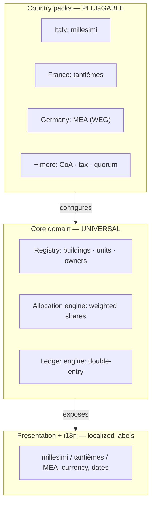
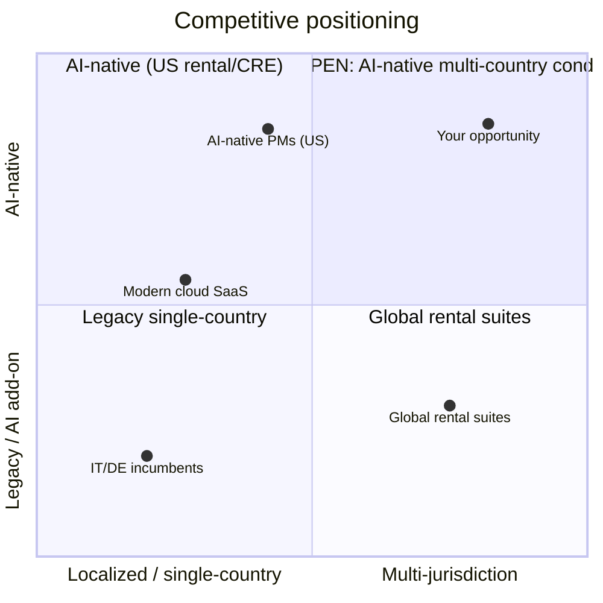

# Project Brief — Condominium Management & Accounting Platform

> **Working title:** CondoLedger _(name not finalized — see [Naming](#naming))_
> **Type:** Web application (SaaS) for property managers / condominium administrators
> **Core idea:** Building administration + full double-entry accounting, built to work across jurisdictions (Italian _millesimi_ first, international via country-specific customization).
> **Status:** Early concept. This brief was generated from a research/scoping session in June 2026 and is meant as living context — refine as decisions are made.

---

## 1. Product concept

A web platform for property managers (_amministratori di condominio_) that combines:

- **Building administration** — registry of buildings, units, and owners; shared-expense allocation; assemblies and budgets; payments, dues, and reserve funds.
- **Double-entry accounting** — a proper general ledger so accounts always balance, with statutory reports per jurisdiction.

The differentiator is **not** double-entry itself (that turned out to be table stakes — see [Competitive landscape](#competitive-landscape)). It is the combination of **multi-jurisdiction by design + AI-native + clean modern architecture**, targeted at the shared-ownership segment (condo / copropriété / WEG) that current AI-native players ignore.

---

## 2. Naming

Marketing names need to travel internationally (avoid Italy-locked terms; note that even "condo" is a US/anglophone term — elsewhere it's _copropriété_ (FR), _WEG/Hausverwaltung_ (DE), _comunidad de propietarios_ (ES), _strata_ (AU), _block management_ (UK)).

| Candidate | Availability finding | Verdict |
|---|---|---|
| **CondoLedger** | No existing product found with this exact name. Closest conceptual competitor: **Condo Control** (US), which already ships a double-entry suite. | **Cleanest candidate** — verify domain + trademark before committing. |
| EstateBooks | Taken — existing "EstateBooks" app on the App Store (real-estate tenancy management). | Avoid. |
| Blockwise | Crowded — multiple companies (algo-trading IT, network-management UK, blockchain consultancy, fintech accounting). | Avoid. |
| Stabile / Palazzo | Not individually checked; common dictionary words → expect trademark conflicts and the exact `.com` likely taken. | Risky / verify. |

**Internal vocabulary should stay neutral** regardless of brand name: use canonical terms in code and data model (`Building`, `Unit`, `Owner`, `AllocationKey`) and let localized labels (_millesimi_, _tantièmes_, _Miteigentumsanteile_) live only in the presentation / i18n layer.

### Verification still required (not yet done)
- **Domain:** check `.com` + `.io`/`.app` + target ccTLDs (`.it`, `.de`, `.fr`, `.co.uk`) on a registrar (Namecheap, GoDaddy, Cloudflare). _(User indicated the domain looks reasonably free.)_
- **Trademark:** check the official registers — EUIPO (EU), UKIPO (UK, separate post-Brexit), USPTO (US). For a real launch, get a professional trademark clearance. _(This brief is not legal advice.)_

---

## 3. Target markets & the dual-market thesis

Serve **both** the Italian market (with _millesimi_) **and** international markets, with per-country customization. The key architectural consequence: the accounting *mechanism* is universal, but the *rules around it* are local.

What is **universal**: double-entry bookkeeping. A balanced debit/credit is the same in Rome, Berlin, or London.

What **varies by country**:
1. **Chart of accounts** and reporting standards.
2. **Rules that generate journal entries** (VAT/tax, withholdings, mandatory reserve funds).
3. **Expense allocation model** (see §4 — the key generalization).
4. **Assembly governance** (quorums, majorities, statutory documents).

---

## 4. Architecture — stable core + pluggable country packs



Each **country pack** supplies four things to the core:
1. A **chart-of-accounts** template (+ reporting standards).
2. **Allocation defaults and constraints** (e.g. shares must sum to 1000 for millesimi).
3. **Tax rules** (VAT, withholdings) that generate journal entries.
4. **Governance rules** (quorums, majorities, mandatory documents).

The core knows nothing about "Italy" or "Germany" — it only consumes configuration.

### 4.1 The key generalization: `AllocationKey`

Millesimi are just **one instance** of a general concept: a weighted distribution table assigning each unit a share of a cost category.

| Country | Local term | Base |
|---|---|---|
| Italy | millesimi (multiple tables: proprietà, scale, riscaldamento — artt. 1123–1126 c.c.) | 1000 |
| France | tantièmes / quote-parts (loi 1965) | varies |
| Germany | Miteigentumsanteile (MEA, under WEG) | varies |
| Spain | cuota de participación (Ley de Propiedad Horizontal) | 100 |
| UK | apportionment per lease | % or fixed |
| USA | percentage interest / assessments (CC&Rs) | % |
| Australia | unit entitlements (strata) | varies |

Model **one** allocation entity; millesimi become an `AllocationKey` with base 1000. Country packs only provide defaults, labels, and validation — not separate "Italian" vs "German" allocation logic.

### 4.2 Engineering principles
- **i18n ≠ domain l10n.** Keep language/formats (i18n) independent from legal/fiscal rules (domain l10n). A Swiss admin may operate in German but under Swiss rules; an Italian may want an English UI with Italian rules.
- **Chart of accounts is data, not code.** Seed from a per-country template but make it editable per administration (studios differ even within one country).
- **Governance as declarative rules.** Model assembly quorums/majorities as a small rule engine (e.g. "majority of attendees representing ≥ X thousandths") populated by the country pack — no `if (country === 'IT')` scattered through the codebase. Adding a country shouldn't touch the core.

### 4.3 Starter data-model sketch (conceptual, refine in Claude Code)

```ts
// Canonical, market-neutral domain entities.
interface Building { id: string; name: string; countryPack: string; /* e.g. "IT" */ }
interface Unit { id: string; buildingId: string; ownerId: string; }
interface Owner { id: string; displayName: string; }

// One entity generalizes millesimi / tantièmes / MEA / strata entitlements.
interface AllocationKey {
  id: string;
  buildingId: string;
  name: string;          // e.g. "proprietà", "heating", "stairs"
  base: number;          // 1000 for millesimi, 100 for ES, etc.
  shares: Record<string /*unitId*/, number>; // must sum to `base` (pack-validated)
}

// Universal double-entry. Same everywhere.
interface Account { id: string; code: string; name: string; type: AccountType; }
type AccountType = "asset" | "liability" | "income" | "expense" | "equity";

interface JournalEntry {
  id: string;
  date: string;
  description: string;
  lines: JournalLine[];  // must balance: sum(debit) === sum(credit)
}
interface JournalLine { accountId: string; debit: number; credit: number; }

// A country pack is configuration consumed by the core.
interface CountryPack {
  code: string;                 // "IT" | "FR" | "DE" | ...
  chartOfAccounts: Account[];   // seed template (editable per admin)
  allocationDefaults: Partial<AllocationKey>[];
  taxRules: unknown;            // VAT/withholding → journal-entry generators
  governanceRules: unknown;     // quorums, majorities, statutory docs
  labels: Record<string, string>; // localized terms for the UI
}
```

> Note: amounts should be stored as **integer minor units** (cents) to avoid floating-point drift — one of the existing IT tools advertises a "centesimi interi" (whole-cents) ledger engine for exactly this reason.

---

## 5. Competitive landscape

**Headline finding: double-entry accounting is a requirement-to-enter, not a differentiator.** It is offered by incumbents everywhere — and in France it is legally mandatory.

| Market | Representative players | Double-entry? | Notes |
|---|---|---|---|
| 🇮🇹 Italy | Arcadia, RipartoIG, Condominio102 Admin, Danea Domustudio, TeamSystem (Domustudio/Brainware); open-source **KondoManager** (Laravel + Vue 3) | Yes (Danea hides it under the hood) | Mature; e-invoicing, MAV, bank reconciliation common. Several codebases are decades old (RipartoIG descends from RipartoDOS, 1990s). |
| 🇩🇪 Germany | Immoware24, INtex, Karthago, Win-CASA, Scalara, Impower | Yes (often "testiert"/audited; DATEV export expected) | Some already ship **AI invoice recognition** (Immoware24, INtex). Scalara/Impower = modern cloud entrants. Many still on-premise / CD-update models. |
| 🇫🇷 France | **Matera** (150k+ users), Vilogi, ARC tools | **Mandatory** (partie double, since the 2005 accounting decree) | Matera is the modern disruptor (online syndic, claims ~30% cost savings). Double-entry must be standard, not a paid option. |
| 🌍 US / intl | Condo Control, Buildium, AppFolio, Yardi, Vantaca | Yes (Condo Control launched a full double-entry GL + AI copilot) | Strong on rental/HOA; less on multi-country condo governance. |
| 🤖 AI-native | MagicDoor, Cambio, SurfaceAI, Beam AI | Varies | **Aimed at US rental / commercial / leasing — not condo.** This is the gap. |

**AI-native is the funded frontier:** ~$16.7B entered PropTech in 2025 (+68% YoY), with ~72% concentrated in a few AI-native players; the explicit divide is "AI-native systems vs. legacy platforms adding AI as a feature." But that wave is pointed at rental/CRE, leaving shared-ownership governance + accounting open.

### Positioning map



---

## 6. Where the competitive advantage is

The top-right quadrant (AI-native + multi-country, for condos) is relatively open, for three mutually reinforcing reasons:

1. **Multi-jurisdiction by design.** Almost every incumbent is single-country because value is locked in local legal/accounting/governance rules. Nobody has the "universal core + country packs" architecture. Hard → defensible.
2. **AI-native for shared-ownership specifically.** The agentic wave looks at US rentals/CRE; condo/copropriété/WEG (assemblies, quorums, riparti, statutory reports) is still legacy or "AI bolt-on."
3. **Clean architecture as a velocity moat.** Many incumbents run 30-year-old codebases (some still on-premise / CD updates). A schema-first, modular, agent-friendly base ships country packs and AI features faster than they can refactor.

### Honest cautions
- **Multi-jurisdiction is the differentiator AND why it's hard.** Per-country compliance depth is enormous. Going wide too early = shallow everywhere.
- **AI-native is getting crowded and well-capitalized.** A small team competes on focus, not funding.
- **Strategy:** multi-country core in the code from day one, but **go-to-market on a single beachhead** you can actually win.

### Beachhead candidate to evaluate
**UK block management / service charge** (where the founder is based): double-entry is *not* legally mandated as in FR/IT, so tooling is often less standardized — potentially a less-crowded wedge. Compare against starting in Italy (founder-familiar, but mature/competitive).

---

## 7. Open questions & next steps

- [ ] Finalize name; run domain + trademark verification (EUIPO/UKIPO/USPTO).
- [ ] Choose the **beachhead market** (UK block management vs Italy vs other).
- [ ] Decide the MVP scope for the first market (registry + allocation + ledger + one statutory report?).
- [ ] Pin down the tech stack (frontend-led; founder is a frontend engineer).
- [ ] Design the `AllocationKey` + `CountryPack` contracts in detail (see §4.3).
- [ ] Do a deep competitive teardown of the chosen market's 3–5 real incumbents (features, pricing, weaknesses).
- [ ] Define the AI-native angle concretely (agentic invoice→ledger posting? assembly minutes? dunning? anomaly detection on the GL?).

---

## 8. References

Key sources backing the claims above (verify/refresh — captured June 2026):

- Arcadia (IT, partita doppia) — https://www.arcadiasoftware.it/gestionale/
- RipartoIG (IT) — https://www.inve.it/prodotti/ripartoig
- Condominio102 Admin (IT, web-based double-entry) — https://www.condominio102.it/
- Danea Domustudio (IT, double-entry hidden under the hood) — https://www.danea.it/software/domustudio/supporto/faq/?id=59
- TeamSystem Condomini (IT) — https://www.teamsystem.com/condomini/
- KondoManager (IT, open-source, Laravel/Vue3) — https://github.com/vince844/kondomanager-free
- Immoware24 (DE, double-entry + AI invoice recognition) — https://www.immoware24.de/hausverwaltung-software/
- German market roundup (INtex, Karthago, Win-CASA, Scalara) — https://www.softwareabc24.de/hausverwaltung-software/
- Matera (FR, online syndic, partie double) — https://matera.eu/fr/articles/syndic-copropriete-logiciel-gestion-syndic
- Condo Control (US, double-entry GL + AI copilot) — https://www.condocontrol.com/
- PropTech AI-native funding shift — https://realestatesolutionist.substack.com/p/agentic-ai-real-estate-operating-systems
- AI-native PM examples — https://magicdoor.com/ , https://www.getsurface.ai/ , https://beam.ai/agents/property-manager/
