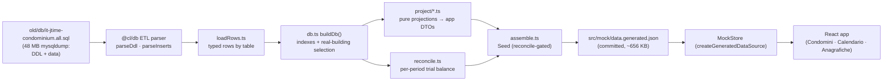
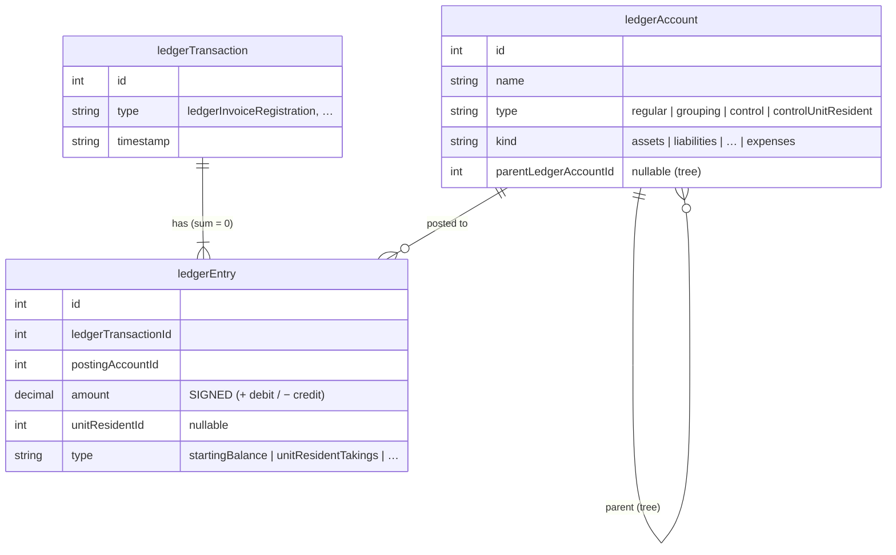
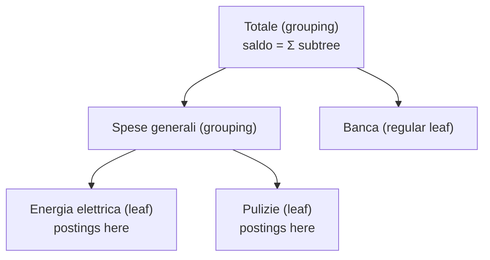
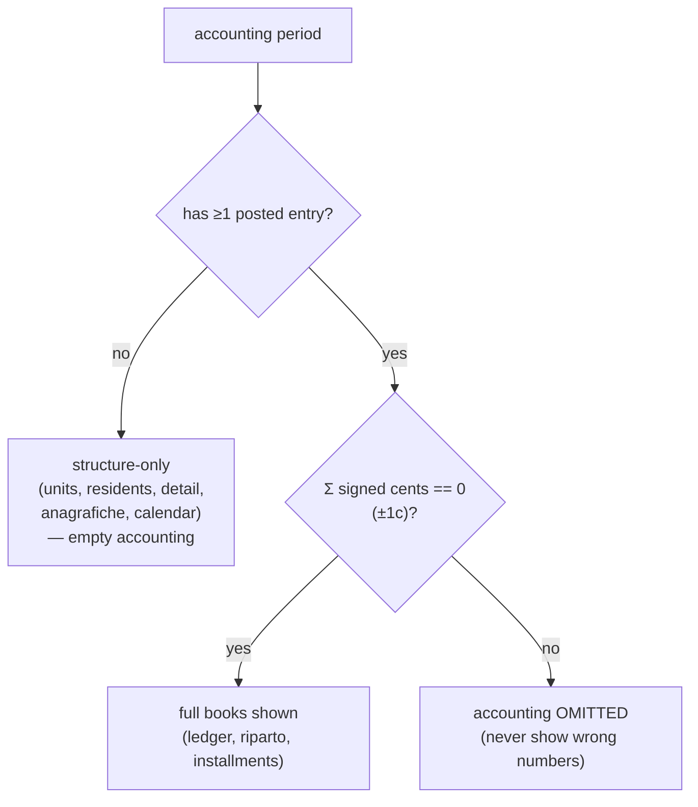
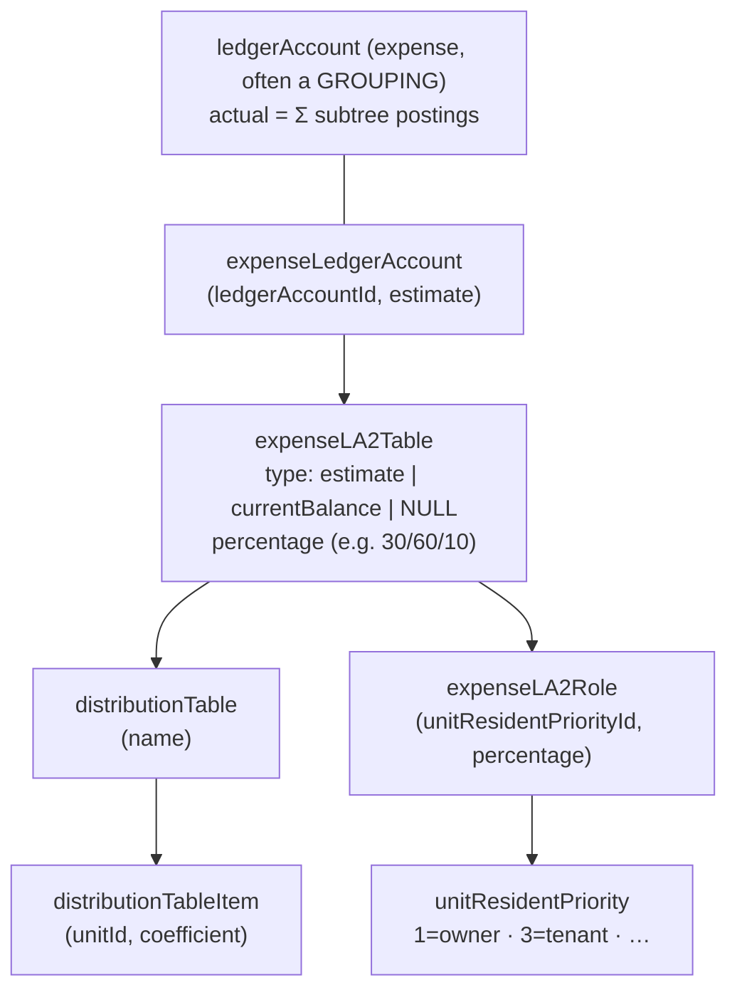
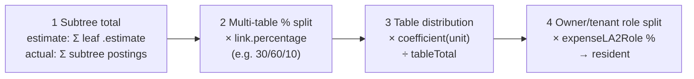
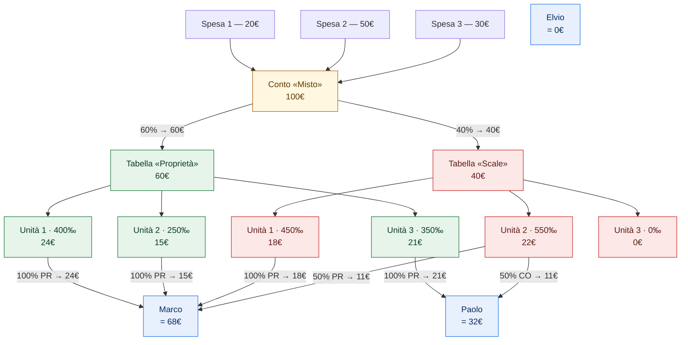

# Accounting & Distribution — How the Numbers Work

> **Scope:** This document explains the *domain mechanics* the app reproduces from the
> legacy `it-jtime` data: double-entry bookkeeping, per-period **reconciliation**, and
> the Italian **distribution (riparto)** engine that allocates shared expenses to units.
> It is grounded in what the generator actually computes
> (`apps/web/tools/gen/`), verified against the real dump
> `old/db/it-jtime-condominium.all.sql`.
>
> For the table shapes referenced here, see [`database-schema.md`](./database-schema.md).
> For the data-source pipeline, see [§1](#1-where-the-numbers-come-from).

---

## 1. Where the numbers come from

The running web app does **not** talk to a database. It reads everything through the
`MockDataSource` port from an in-memory `MockStore`, seeded by a static JSON file that an
**offline generator** produces from the legacy SQL dump.

Key properties:

- **Pure functions, no DB at runtime.** Every projection in `apps/web/tools/gen/project/`
  is a pure function `(db, periodId) → DTO`. The dump is read once at *generation* time;
  the committed JSON is the app's seed, so build/CI never need the 48 MB file.
- **Money is integer cents.** Every monetary value is `Money = { cents: number }`
  (`@cl/domain`). Legacy decimal strings like `"-44.20"` are parsed once via `eur()` →
  `{ cents: -4420 }`. No floating-point money flows through the app.
- **Fixtures vs generated.** Tests run against the small curated `fixtures.ts` seed
  (`MockStore()` default); only the running app uses the full generated seed
  (`createGeneratedDataSource()`). This keeps test counts stable while the app shows real data.

---

## 2. Double-entry accounting

### 2.1 The signed-amount convention

The legacy ledger uses a **single signed amount per entry**, not separate debit/credit
columns. A `ledgerTransaction` groups several `ledgerEntry` rows, and **the entries of a
transaction sum to zero** — that is the double-entry invariant.

For any single posting account, the displayed columns are derived from the signed amounts:

| Column | Formula (over the account's entries) |
|---|---|
| **Dare** (debit) | `Σ max(0, amount)` |
| **Avere** (credit) | `Σ −min(0, amount)` |
| **Saldo** (balance) | `Σ amount` (= Dare − Avere) |

This is implemented by `dareAvereSaldo()` in `tools/gen/project/../amounts.ts` and used
throughout `project/accounting.ts`.

### 2.2 A worked transaction

A cleaning invoice of €120.00, paid from the bank:

| entry | account | signed amount | Dare | Avere |
|---|---|---:|---:|---:|
| 1 | Pulizie (expense) | `+120.00` | 120.00 | — |
| 2 | Banca (asset) | `−120.00` | — | 120.00 |
| | **transaction total** | **0.00** | **120.00** | **120.00** |

The transaction balances (sum = 0); the header shows Dare = Avere = €120.00.
`projectTransactions()` produces exactly this shape: per-entry `{accountId, account, dare, avere}`
plus a balanced header total.

### 2.3 The account tree & roll-up

`ledgerAccount` rows form a tree via `parentLedgerAccountId`. Postings land on **leaf**
accounts; **grouping** accounts (`type = "grouping"`) have no direct postings — their
balances are the **sum of their subtree**.

`projectAccounts(db, periodId)` builds this recursively: a node's `saldo` is its own
signed postings plus the signed roll-up of every child; `dare`/`avere` of a grouping is the
roll-up of its children's sides. The result is the tree shown in the **Conti** section.

> **Verified on real data:** for Saturno 2011 the tree has 60 accounts over 18 transactions;
> for Pozzetto 2013, 82 accounts over 140 transactions. Both roots roll up to **saldo = 0**
> (the trial balance — see §3), and the tree total equals the flat sum of all entries (no
> double-counting).

---

## 3. Reconciliation

### 3.1 The gate

A period's books are only shown when they are **trustworthy**. `reconcilePeriods(db)`
computes, per accounting period:

- **`hasBooks`** — the period has ≥ 1 posted `ledgerEntry`.
- **`reconciles`** — `|Σ all signed entry cents| ≤ 1` (the trial balance nets to zero,
  within a one-cent rounding tolerance). Periods with no books are vacuously reconciling.

`assemble.ts` applies the gate: it **always** ships structure (the building tree, period
detail, units/residents, suppliers, F24, anagrafiche, calendar), and ships accounting views
(`ledgerAccountsByPeriod`, `ledgerTxnsByPeriod`, `distribution*`, `installments*`) **only**
when `hasBooks && reconciles`. Everything else is emitted empty.

### 3.2 What this dataset contains

| | result |
|---|---|
| Periods with reconciling books | **2** — Saturno 2011 (`p1`), Pozzetto 2013 (`p36`); both trial-balance to **exactly €0.00** |
| Structure-only periods | **18** (no posted books in the dump) |
| Unbalanced books (would be omitted) | **0** |

So the app honestly shows full accounting for two periods and structure-only for the rest —
never fabricated figures. This is the design answer to "show all real buildings; books where
they exist."

---

## 4. The distribution (riparto) engine

This is the most intricate part of the domain. Italian condominium accounting allocates each
shared **expense** to units in proportion to a **distribution table** (the _millesimi_ /
thousandths idea), with several real-world complications. The engine lives in
`apps/web/tools/gen/project/riparto.ts` and feeds both the **Tabelle/Riparto** matrices
(`distribution.ts`) and the **Unità** per-resident `preventivo`/`consuntivo`
(`units.ts`).

### 4.1 The data model

Read it as: an **expense account** is linked (via `expenseLA2Table`) to one or more
**distribution tables**; each table assigns every **unit** a **coefficient**; and each link
may further split its amount across **resident roles** (owner vs tenant) via
`expenseLA2Role`.

### 4.2 The four layers

The amount a unit (and then a resident) owes for an expense account is computed by composing
four layers. Each was discovered/verified against the real dump.

1. **Subtree roll-up.** Distribution links sit on **grouping** accounts, but money and
   estimates live on their **leaf children**. So the account's total =
   `Σ` over its subtree — **excluding any descendant that is itself a linked account**
   (that descendant owns its own subtree, preventing double-counting).
   - *estimate* total = `Σ expenseLedgerAccount.estimate` across the owned subtree.
   - *actual* total = `Σ` signed `ledgerEntry.amount` posted to the owned subtree.
2. **Multi-table percentage split.** An account may link to several tables, each weighted by
   `expenseLA2Table.percentage` (e.g. heating split `30% / 60% / 10%` across three tables).
   `null` percentage means 100%.
3. **Table distribution.** Within a table, a unit's share is
   `amount × coefficient(unit) ÷ Σ coefficients`. Coefficients are the _millesimi_.
4. **Estimate vs consuntivo table selection.** `expenseLA2Table.type` chooses the table per
   matrix: the **estimate** (preventivo) matrix uses `type = 'estimate'` links (falling back
   to untyped `NULL` links); the **current** (consuntivo) matrix uses `type = 'currentBalance'`
   links (falling back to `NULL`). `expenseLA2Table.type` is a nullable
   `enum('estimate','currentBalance')` — `NULL` means "untyped", usable by either matrix when
   no typed link exists. So preventivo and consuntivo can legitimately use *different* tables.
5. **Owner/tenant role split.** `expenseLA2Role` assigns each link's per-unit amount to
   residents of a given **priority** (1 = owner/_proprietario_, 3 = tenant/_conduttore_) at a
   percentage. A "50% proprietari / 50% conduttori" account splits accordingly. If a unit has
   no resident of the charged role (e.g. a tenant-charged expense on an owner-occupied unit),
   the orphaned share falls to the **owner** so totals are conserved.

> The full per-resident amount for an account is therefore:
> `Σ over links L of [ subtreeTotal(mode) × pct(L) × coeff(L.table, unit) ÷ tableTotal(L.table) ] × roleShare(resident, L)`

### 4.3 Worked example — from three expenses to three people's bills

This is the canonical end-to-end trace: **how €100 of expenses ends up as a specific euro
amount owed by a specific person** (owner or tenant). It looks tangled at first glance, but it
is just the four layers of §4.2 applied once. Follow the money top-to-bottom.

**The setup**

- Three expenses are booked into **one** expense account, *Misto*: `Spesa 1 = 20€`,
  `Spesa 2 = 50€`, `Spesa 3 = 30€` → **100€** total.
- *Misto* is distributed across **two** tables by percentage: **Proprietà 60%** (60€) and
  **Scale 40%** (40€).
- Two tables, two sets of coefficients (_millesimi_) **and** two independent owner/tenant
  (PR/CO) rules:

| | Unità 1 | Unità 2 | Unità 3 | role rule (per table) |
|---|---:|---:|---:|---|
| **Proprietà** (60€) | 400‰ | 250‰ | 350‰ | **100% PR** (owner) for every unit |
| **Scale** (40€) | 450‰ | 550‰ | 0‰ | U1 **100% PR**; U2 **50% PR / 50% CO**; U3 — |

- Who owns / rents what:

| unit | owner (PR) | tenant (CO) |
|---|---|---|
| Unità 1 | **Marco** | — |
| Unità 2 | **Marco** | **Paolo** |
| Unità 3 | **Paolo** | **Elvio** |

> The crucial, non-obvious point: **the owner/tenant split lives on the table, not on the unit.**
> The very same Unità 2 is billed *100% to its owner* through Proprietà (green) but *50/50
> owner/tenant* through Scale (red). That is why the diagram colours each table's path
> differently — a unit can route money to different people depending on which table the cost
> came through.

**The flow** (green = Proprietà, red = Scale)

**Read it in five steps**

1. **Expenses → account.** Three costs are recorded against the single *Misto* account: 20 + 50 + 30 = **100€**.
2. **Account → tables.** *Misto* is split by table percentages: **60€** down the green
   *Proprietà* path, **40€** down the red *Scale* path. (100€ preserved.)
3. **Table → units (by coefficient).** Each table divides its slice by its own _millesimi_:
   - *Proprietà* 60€ over 400/250/350 ‰ → **24€ / 15€ / 21€** for U1 / U2 / U3.
   - *Scale* 40€ over 450/550/0 ‰ → **18€ / 22€ / 0€** for U1 / U2 / U3.
   - Per unit (both tables): U1 = 42€, U2 = 37€, U3 = 21€ → still **100€**.
4. **Unit → payer (by the table's role rule).** Each unit-share is handed to a person using
   *that table's* PR/CO split:
   - *Proprietà* (100% owner everywhere): U1 24€ → Marco, U2 15€ → Marco, U3 21€ → Paolo.
   - *Scale*: U1 18€ → Marco (owner); U2 22€ splits **11€ → Marco (owner)** and **11€ → Paolo (tenant)**; U3 has 0€.
5. **Sum per person.** Add every euro routed to each payer across both tables.

**The allocation matrix** (who pays what, by table)

| Payer | via Proprietà (green) | via Scale (red) | **Total** |
|---|---:|---:|---:|
| **Marco** (owns U1, U2) | 24 + 15 = 39€ | 18 + 11 = 29€ | **68€** |
| **Paolo** (owns U3; rents U2) | 21€ | 11€ | **32€** |
| **Elvio** (rents U3) | 0€ | 0€ | **0€** |
| **Total billed** | 60€ | 40€ | **100€** ✓ |

**Why Paolo's and Elvio's tenancies don't always matter.** Paolo *rents* Unità 2, but
Proprietà charges U2 100% to its owner (Marco), so Paolo pays nothing there; he only picks up
11€ from Scale's 50% tenant share on U2. Paolo also *owns* Unità 3, so its Proprietà share
(21€) is his. Elvio rents Unità 3, but no table routes any tenant-charged cost to U3
(Proprietà is 100% owner; Scale allocates U3 = 0€), so Elvio owes **0€**.

**It reconciles.** Marco 68€ + Paolo 32€ + Elvio 0€ = **100€** — exactly the three original
expenses. No euro is created or lost; this conservation is the tie-out gate of §4.4 applied to
a single account.

> In the engine (`riparto.ts`), this whole trace is `perResidentAmount()`: for each linked
> table it computes `accountTotal × tablePct × coeff(unit)/tableTotal`, then splits that
> per-unit amount across the unit's residents by the table's `expenseLA2Role` rule — with any
> role share that has no matching resident falling back to the owner so the 100€ always lands
> somewhere.

> **Estimate vs consuntivo.** The trace above uses one set of amounts. The **preventivo**
> (estimate) matrix runs it with each account's *budgeted* `estimate`; the **consuntivo**
> (current) matrix runs the identical machinery with the account's *actual* posted total,
> selecting the `currentBalance` table when one is linked (§4.2, step 4).

### 4.4 Tie-out (the correctness gate)

The engine is only trustworthy if the distributed amounts **sum back to the expense totals**.
Verified on real data:

| period | estimate: source → matrix | actual: source → matrix | Σ resident vs matrix |
|---|---|---|---|
| Saturno 2011 | €7,400.00 → €7,399.99 (−1¢) | €2,455.19 → €2,455.21 (+2¢) | €0.00 gap |
| Pozzetto 2013 | €38,000.00 → €38,000.04 (+4¢ / 198 cells) | €34,398.65 → €34,398.62 (−3¢) | €0.00 gap |

All gaps are sub-cent-per-cell rounding; the role split conserves totals exactly. The only
amounts intentionally *outside* the table distribution are **directly-attributed individual
expenses** (e.g. postal fees / _solleciti_ charged to one resident via `unitResidentId` on an
unlinked account subtree) — those are added straight to that resident's consuntivo
(`units.ts`), so a resident's consuntivo = table-distributed share + individual charges,
which ties to the total actual expense (Pozzetto: €34,398.62 + €489.06 ≈ €34,887.71 total).

---

## 5. How it surfaces in the UI

The **Unità** grid shows, per resident, the figures that tie the accounting to the people who
owe money:

| Column | Meaning | Source |
|---|---|---|
| **Saldo prec.** | opening balance carried in | `unitResident.startingBalance` |
| **Preventivo** | budgeted share of the estimate | riparto **estimate** distribution (§4) |
| **Consuntivo** | actual share of real expenses | riparto **current** distribution + individual charges |
| **Tot. dovuto** | total owed | `saldoPrec + preventivo` |
| **Versato** | paid in | `−Σ` `unitResidentTakings` ledger entries (a takings credit shown positive) |

The **Rate** (installments) view is materialized directly: each `installmentItem.amount` per
resident per installment, summed to `totPreventivo`; `group.totPreventivo` equals
`Σ installmentItem.amount` exactly.

The **Tabelle / Riparto** matrices are the per-unit estimate and current grids from §4, one
column per linked expense account.

---

## 6. Quirks of this dataset (worth remembering)

- **No `individualExpense` rows.** Despite the enum, no `ledgerEntry.type = 'individualExpense'`
  exists. Per-unit charges are reconstructed via the riparto engine (§4) and the
  `estimateDistribution` / `closingBalance` transactions, not read off entries.
- **Two periods have books.** Only Saturno 2011 and Pozzetto 2013 reconcile; the rest are
  structure-only by design.
- **9 real buildings.** Junk/test condominiums are excluded; one real building (Pozzetto) has
  a `NULL` code, and one (Sole) is a `type = super` parent with no direct units — both are
  intentionally kept (see [`database-schema.md`](./database-schema.md) → "Quirks").
- **Calendar has no layers in the dump** — events are shown under a single synthesized
  "Generale" layer.
- **Distribution tables reference no consumption meters** (`consumptionMeterId` unused), so
  every split is coefficient/percentage-based and fully reconstructable.
