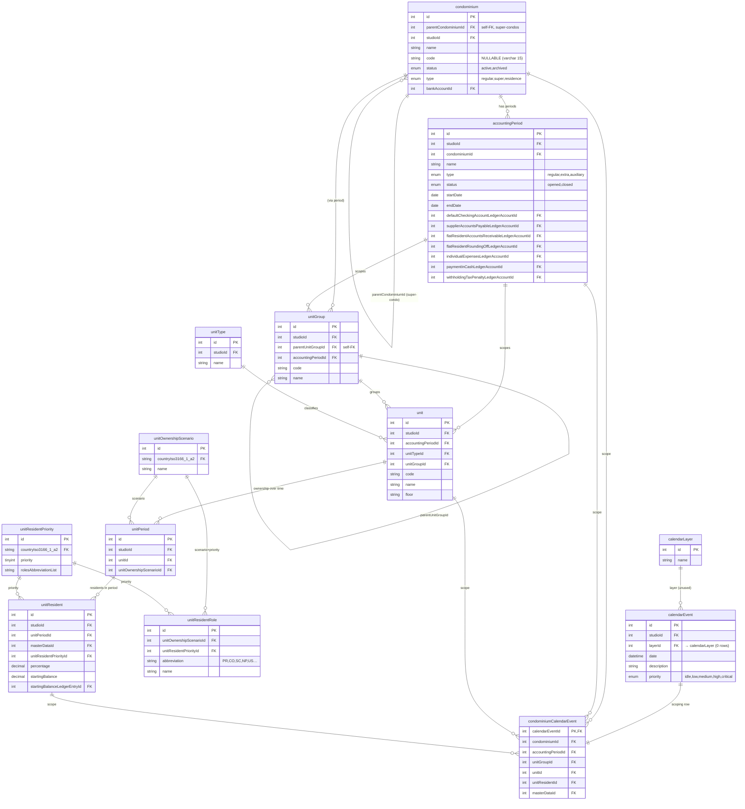
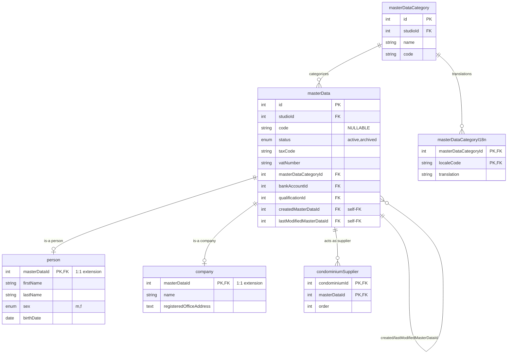
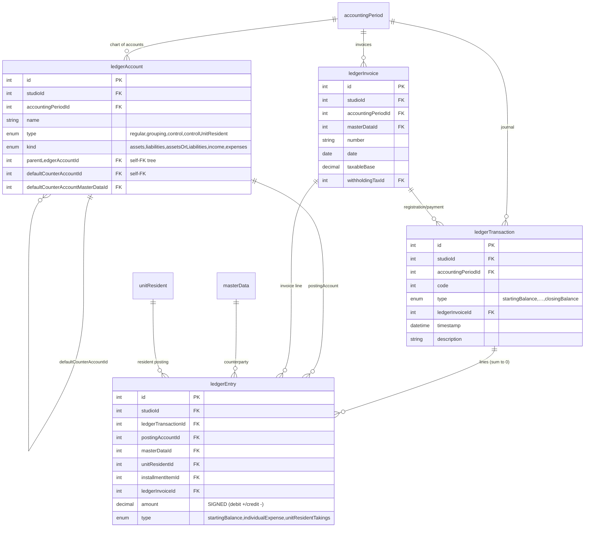
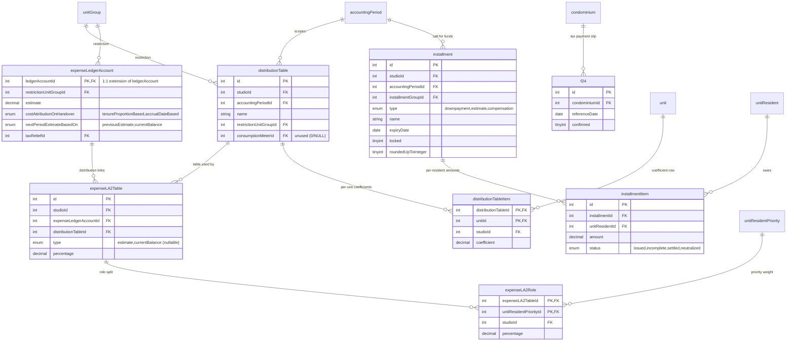

# Domain Database Schema — Core Tables

> **Scope & source of truth.** This document mirrors the legacy **`it-jtime`** MySQL
> schema — the source from which the app's data is projected (see the ETL pipeline in
> [`accounting-and-distribution.md`](./accounting-and-distribution.md)). Every column,
> type, enum, nullability, and foreign key below is read directly from the real dump
> `old/db/it-jtime-condominium.all.sql` (a 48 MB `mysqldump`, MySQL 5.x / InnoDB,
> `utf8_unicode_ci`).
>
> The legacy database has **95 tables**. This document covers the **~30 core domain
> tables** that the condominium app actually uses. Peripheral tables exist and are
> **out of scope** here, including: geographic reference data (`country`, `city`,
> `district`, `state`, `postCode`, `minorCivilDivision` + their `*I18n`), banking
> (`bank`, `bankBranch`, `bankAccount`, `bankTransferPO`), access/auth (`accessAccount*`,
> `passwordResetRequest`, `codeIgniterSession`, `license`), studio/property-manager
> registry (`studio`, `propertyManager*`), tax/fiscal lookups (`tribute`, `taxRelief`,
> `withholdingTax`, `withholdingTax2LA`, `qualification`, `grant*`), masterData
> satellites (`masterDataContact*`, `masterDataCrossRelation*`, `masterDataTaxTreatment`,
> `*Variation`), ticketing (`ticket*`), and the various `*I18n` translation side-tables
> (kept out of the diagrams to reduce noise; their shape is uniform —
> `(<parent>Id, localeCode, translation…)`).

## Cross-cutting conventions

These hold across almost all core tables; they are **not** repeated in every per-table note.

- **Multi-tenant via `studioId`.** This dump contains exactly **one** studio
  (`studioId = 1`). Most operational tables carry a `studioId int unsigned` FK →
  `studio(id)`. A few reference/junction tables that hang off a parent omit it.
- **`id int(10) unsigned AUTO_INCREMENT`** is the surrogate PK on entity tables.
  Junction/extension tables instead use a natural composite PK or share the parent's PK
  (1:1 extension, e.g. `person.masterDataId`, `company.masterDataId`,
  `expenseLedgerAccount.ledgerAccountId`).
- **`created` / `lastModified` `datetime`** audit columns exist on nearly every table,
  set by `BEFORE INSERT` / `BEFORE UPDATE` triggers. Omitted from the tables below.
- **Money is `decimal(10,2)`.** Where it is `unsigned` the sign is carried elsewhere
  (see the **signed `ledgerEntry.amount`** convention in §3).
- **Enums are reproduced verbatim** from the DDL, in declaration order.

---

## 1. Registry, Units & Calendar

---

## 2. Master Data (anagrafiche)

`masterData` is the **polymorphic party** record (a row is *either* a `person` *or* a
`company` — never both — via a shared-PK 1:1 extension). The same `masterData` row can be
a resident (`unitResident.masterDataId`), an invoice counterparty
(`ledgerInvoice.masterDataId`), a supplier (`condominiumSupplier`), or a ledger
counter-account holder.

---

## 3. Ledger (double-entry)

The journal is classic **double-entry**: a `ledgerTransaction` owns N `ledgerEntry` lines
whose **signed** `amount`s sum to zero. `ledgerEntry.amount` is `decimal(10,2)` (NOT
unsigned) — **the sign is the debit/credit convention**. `postingAccountId` chooses the
chart-of-accounts node; `unitResidentId` / `masterDataId` attach the line to a resident or
party. `unitResident.startingBalanceLedgerEntryId` points back to the opening-balance line.

---

## 4. Distribution (riparto) & Installments

An **expense ledger account** (`expenseLedgerAccount`, a 1:1 extension of a `ledgerAccount`
whose `kind = expenses`) is allocated to units via one or more **distribution tables**.
`expenseLA2Table` is the link (expense account → table) and its `type` distinguishes the
**estimate** table from the **currentBalance** (final-balance) table; `percentage` lets a
single account be split across multiple tables. `distributionTableItem.coefficient` is the
per-unit weight (the *millesimi*). `expenseLA2Role` further splits an account's share by
resident **priority** (owner vs tenant) when costs are divided between roles.

---

## 5. Per-table reference

> Columns shown are the **domain-meaningful** ones (PK, FKs, enums, money, key
> attributes). Ubiquitous `studioId`, `created`, `lastModified` and indexes are omitted
> except where notable. Types are the exact MySQL types from the DDL.

### `condominium` — the building / complex registry
| Column | Type / enum | Notes |
|---|---|---|
| `id` | int unsigned PK | |
| `parentCondominiumId` | int unsigned, **NULL** | **self-FK** → `condominium(id)`; set for sub-buildings of a super-condo. `ON DELETE SET NULL`. |
| `studioId` | int unsigned NOT NULL | FK → `studio`. |
| `name` | varchar(63) NOT NULL | unique per studio. |
| `code` | varchar(15) **NULL** | unique per studio when present; **can be NULL** (e.g. *Pozzetto*). |
| `status` | enum(`active`,`archived`) | default `active`. |
| `type` | enum(`regular`,`super`,`residence`) | default `regular`. `super` = parent of a super-condo; `residence` = a residential complex variant. |
| `bankAccountId` | int unsigned NULL | FK → `bankAccount`, `ON DELETE SET NULL`. |
| `address`,`taxCode`,`vatNumber`,`landRegistry` | text / varchar | descriptive. |

### `accountingPeriod` — the bookkeeping period for one condominium
| Column | Type / enum | Notes |
|---|---|---|
| `id` | int unsigned PK | |
| `condominiumId` | int unsigned NOT NULL | FK → `condominium`. Unique `(condominiumId, name)`. |
| `name` | varchar(31) | e.g. `2011`, `2010-2011`, or a free-text extra-job name. |
| `type` | enum(`regular`,`extra`,`auxiliary`) | default `regular`. `extra` = one-off works (no calendar bounds required); `auxiliary` = side account. |
| `status` | enum(`opened`,`closed`) | default `opened`. |
| `startDate` / `endDate` | date / date NULL | `endDate` NULL for open-ended extra jobs. |
| `defaultCheckingAccountLedgerAccountId` | int unsigned NULL | FK → `ledgerAccount`, `ON DELETE SET NULL`. The period's **functional account** wiring. |
| `supplierAccountsPayableLedgerAccountId` | int unsigned NULL | FK → `ledgerAccount`. |
| `flatResidentAccountsReceivableLedgerAccountId` | int unsigned NULL | FK → `ledgerAccount`. |
| `flatResidentRoundingOffLedgerAccountId` | int unsigned NULL | FK → `ledgerAccount`. |
| `individualExpensesLedgerAccountId` | int unsigned NULL | FK → `ledgerAccount`. |
| `paymentInCashLedgerAccountId` | int unsigned NULL | FK → `ledgerAccount`. |
| `withholdingTaxPenaltyLedgerAccountId` | int unsigned NULL | FK → `ledgerAccount`. Mostly NULL in this dump. |

> These functional-account columns let a posting routine resolve "which account is the
> bank / the AP / the AR" for the period without hard-coding account ids.

### `unitGroup` — building / staircase grouping of units
| Column | Type / enum | Notes |
|---|---|---|
| `id` | int unsigned PK | |
| `parentUnitGroupId` | int unsigned NULL | **self-FK** → `unitGroup(id)`, `ON DELETE CASCADE`. |
| `accountingPeriodId` | int unsigned NOT NULL | FK → `accountingPeriod`. |
| `code` / `name` | varchar | both indexed; `code` NOT NULL. |

### `unit` — a real-estate unit (apartment, box, …) within a period
| Column | Type / enum | Notes |
|---|---|---|
| `id` | int unsigned PK | |
| `accountingPeriodId` | int unsigned NOT NULL | FK → `accountingPeriod` (`ON DELETE CASCADE`). Units are **period-scoped**. |
| `unitTypeId` | int unsigned NULL | FK → `unitType`, `ON DELETE SET NULL`. |
| `unitGroupId` | int unsigned NULL | FK → `unitGroup`, `ON DELETE CASCADE`. |
| `code`,`name`,`floor`,`innerNumber`,`subordinateNumber` | varchar | location/identity. |
| `landRegistry` | varchar(127) | cadastral reference. |

### `unitPeriod` — links a unit to an ownership scenario for the period
| Column | Type / enum | Notes |
|---|---|---|
| `id` | int unsigned PK | |
| `unitId` | int unsigned NOT NULL | FK → `unit`, `ON DELETE CASCADE`. |
| `unitOwnershipScenarioId` | int unsigned NOT NULL | FK → `unitOwnershipScenario`. Picks the role set (full ownership vs split usufruct, etc.). |
| `periodRestrictionStartDate`/`EndDate` | date NULL | partial-period tenure window. |

### `unitResident` — a party occupying/owning a unit in a given period
| Column | Type / enum | Notes |
|---|---|---|
| `id` | int unsigned PK | |
| `unitPeriodId` | int unsigned NOT NULL | FK → `unitPeriod`, `ON DELETE CASCADE`. Unique `(unitPeriodId, masterDataId)`. |
| `masterDataId` | int unsigned NOT NULL | FK → `masterData`. The party (person/company). |
| `systemUsername` | varchar(63) NOT NULL | FK → `unitResidentAccount(systemUsername)` (web-portal login). |
| `unitResidentPriorityId` | int unsigned NOT NULL | FK → `unitResidentPriority`. Owner/tenant/etc. role. |
| `percentage` | decimal(10,6) unsigned NULL | ownership/occupancy share. |
| `startingBalance` | decimal(10,2) NOT NULL | opening balance (default `0.00`). |
| `startingBalanceLedgerEntryId` | int unsigned NULL | FK → `ledgerEntry`, `ON DELETE SET NULL`. Links the opening balance to its journal line. |

### `unitResidentPriority` — role priority (owner outranks tenant)
| Column | Type / enum | Notes |
|---|---|---|
| `id` | int unsigned PK | |
| `countryIso3166_1_a2` | char(2) | FK → `country`. |
| `priority` | tinyint unsigned | 1 = highest (owner). |
| `rolesAbbreviationList` | varchar(15) | e.g. `PR/NP/LE`, `US/CF`, `CO`, `SC`. |

### `unitResidentRole` — scenario × priority → named role
| Column | Type / enum | Notes |
|---|---|---|
| `id` | int unsigned PK | |
| `unitOwnershipScenarioId` | int unsigned NOT NULL | FK → `unitOwnershipScenario`. |
| `unitResidentPriorityId` | int unsigned NOT NULL | FK → `unitResidentPriority`. |
| `abbreviation` | varchar(15) | `PR`=Proprietario (owner), `CO`=Conduttore (tenant), `SC`=Subconduttore, `NP`=Nudo proprietario, `US`=Usufruttuario. |
| `name` / `pluralName` | varchar(63) | localized via `unitResidentRoleI18n`. |

### `unitOwnershipScenario` — the ownership template set
| Column | Type / enum | Notes |
|---|---|---|
| `id` | int unsigned PK | |
| `countryIso3166_1_a2` | char(2) | FK → `country`. |
| `name` | varchar(63) | e.g. full ownership vs bare-ownership+usufruct. |

### `unitType` / `unitTypeI18n`
`unitType(id, studioId→studio, name)`; translations in
`unitTypeI18n(unitTypeId PK,FK, localeCode PK,FK→locale, translation)`.

### `masterData` — polymorphic party (anagrafica)
| Column | Type / enum | Notes |
|---|---|---|
| `id` | int unsigned PK | |
| `studioId` | int unsigned **NULL** | FK → `studio`, `ON DELETE SET NULL` (shared/system parties may have NULL). |
| `code` | varchar(15) NULL | unique `(code, studioId)`. |
| `status` | enum(`active`,`archived`) | default `active`. |
| `taxCode` / `vatNumber` | varchar(31) | fiscal identifiers. |
| `masterDataCategoryId` | int unsigned NULL | FK → `masterDataCategory`. |
| `bankAccountId` | int unsigned NULL | FK → `bankAccount`. |
| `createdMasterDataId` / `lastModifiedMasterDataId` | int unsigned NULL | **self-FKs** → `masterData(id)` (audit author). |

### `person` — 1:1 extension of `masterData`
| Column | Type / enum | Notes |
|---|---|---|
| `masterDataId` | int unsigned PK,FK | shared PK, `ON DELETE CASCADE`. |
| `firstName`/`middleName`/`lastName` | varchar(63) NULL | indexed. |
| `sex` | enum(`m`,`f`) NULL | |
| `birthDate` | date NULL | |
| `citizenshipIso3166_1_a2` | char(2) NULL | FK → `country`. |

### `company` — 1:1 extension of `masterData`
| Column | Type / enum | Notes |
|---|---|---|
| `masterDataId` | int unsigned PK,FK | shared PK, `ON DELETE CASCADE`. |
| `name` | varchar(127) NOT NULL | indexed. |
| `registeredOfficeAddress` / `taxPurposeAddress` | text | serialized `AddressVO` in the dump. |

### `masterDataCategory` / `masterDataCategoryI18n`
`masterDataCategory(id, studioId→studio NULL, name, code)`, unique `(code, studioId)`.
Translations in `masterDataCategoryI18n(masterDataCategoryId PK,FK, localeCode PK,FK,
translation)`.

### `condominiumSupplier` — many-to-many: building ↔ supplier party
| Column | Type / enum | Notes |
|---|---|---|
| `condominiumId` | int unsigned PK,FK | `ON DELETE CASCADE`. |
| `masterDataId` | int unsigned PK,FK | the supplier party. |
| `order` | int unsigned NULL | display ordering. |

### `ledgerAccount` — chart of accounts (per period)
| Column | Type / enum | Notes |
|---|---|---|
| `id` | int unsigned PK | |
| `accountingPeriodId` | int unsigned NOT NULL | FK → `accountingPeriod`, `ON DELETE CASCADE`. |
| `name` | varchar(255) | indexed. |
| `type` | enum(`regular`,`grouping`,`control`,`controlUnitResident`) | default `regular`. `grouping` = subtotal node; `control`/`controlUnitResident` = control accounts. |
| `kind` | enum(`assets`,`liabilities`,`assetsOrLiabilities`,`income`,`expenses`) | NOT NULL. Drives balance-sheet vs P&L placement. |
| `parentLedgerAccountId` | int unsigned NULL | **self-FK tree** → `ledgerAccount(id)`, `ON DELETE CASCADE`. |
| `defaultCounterAccountId` | int unsigned NULL | self-FK → `ledgerAccount`. Default contra-account. |
| `defaultCounterAccountMasterDataId` | int unsigned NULL | FK → `masterData`. |
| `balance{Hard,Soft}{Lower,Upper}Limit` | decimal(10,2) NULL | optional guard rails. |

### `ledgerTransaction` — a journal entry (groups balanced lines)
| Column | Type / enum | Notes |
|---|---|---|
| `id` | int unsigned PK | |
| `accountingPeriodId` | int unsigned NOT NULL | FK → `accountingPeriod`. Unique `(code, accountingPeriodId)`. |
| `code` | int NOT NULL | human-facing transaction number within the period. |
| `type` | enum (10 values, see below) | the operation kind. |
| `ledgerInvoiceId` | int unsigned NULL | FK → `ledgerInvoice`, `ON DELETE SET NULL`. |
| `timestamp` | datetime NULL | posting date. |

**`ledgerTransaction.type` (verbatim, full enum):**
`startingBalance`, `directPaymentInCash`, `checkingAccountDirectPayment`,
`ledgerInvoiceRegistration`, `ledgerInvoicePayment`, `withholdingTaxPayment`,
`estimateDistribution`, `unitResidentTakings`, `individualExpense`, `closingBalance`.

### `ledgerEntry` — one posting line (the SIGNED amount)
| Column | Type / enum | Notes |
|---|---|---|
| `id` | int unsigned PK | |
| `ledgerTransactionId` | int unsigned NOT NULL | FK → `ledgerTransaction`, `ON DELETE CASCADE`. |
| `postingAccountId` | int unsigned NOT NULL | FK → `ledgerAccount`. The account hit by this line. |
| `masterDataId` | int unsigned NULL | FK → `masterData`. Counterparty, if any. |
| `unitResidentId` | int unsigned NULL | FK → `unitResident`. Resident attribution. |
| `installmentItemId` | int unsigned NULL | FK → `installmentItem`. |
| `ledgerInvoiceId` | int unsigned NULL | FK → `ledgerInvoice`, `ON DELETE SET NULL`. |
| `amount` | **decimal(10,2) (signed)** | **debit/credit carried by the sign.** Lines of a transaction sum to 0. |
| `order` | int unsigned NOT NULL | line ordering. |
| `type` | enum(`startingBalance`,`individualExpense`,`unitResidentTakings`) NULL | line classification. **`individualExpense` never appears in this dump** (only `startingBalance` and `unitResidentTakings` are present in data). |

### `ledgerInvoice` — a supplier invoice
| Column | Type / enum | Notes |
|---|---|---|
| `id` | int unsigned PK | |
| `accountingPeriodId` | int unsigned NOT NULL | FK → `accountingPeriod`. |
| `masterDataId` | int unsigned NOT NULL | FK → `masterData` (the supplier). |
| `number` | varchar(15) | invoice number. |
| `date` / `expiryDate` / `settlementDate` | date / NULL / NULL | |
| `taxableBase` | decimal(10,2) unsigned NOT NULL | net amount. |
| `vatPercentage`,`welfareTaxPercentage` | decimal(5,2) NULL | |
| `withholdingTaxId` | int unsigned NULL | FK → `withholdingTax`. |

### `expenseLedgerAccount` — expense-account extension (1:1 of `ledgerAccount`)
| Column | Type / enum | Notes |
|---|---|---|
| `ledgerAccountId` | int unsigned PK,FK | shared PK → `ledgerAccount`, `ON DELETE CASCADE`. |
| `restrictionUnitGroupId` | int unsigned NULL | FK → `unitGroup`, `ON DELETE SET NULL`. Limits the expense to one group. |
| `estimate` | decimal(10,2) NULL | budgeted amount for the period. |
| `useDistinctTablesForEstimate` | tinyint(1) unsigned | flag. |
| `costAttributionOnHandover` | enum(`tenureProportionBased`,`accrualDateBased`) | default `tenureProportionBased`. |
| `nextPeriodEstimateBasedOn` | enum(`previousEstimate`,`currentBalance`) | default `currentBalance`. |
| `taxReliefId` | int unsigned NULL | FK → `taxRelief`. |

### `expenseLA2Table` — link: expense account → distribution table
| Column | Type / enum | Notes |
|---|---|---|
| `id` | int unsigned PK | |
| `expenseLedgerAccountId` | int unsigned NOT NULL | FK → `expenseLedgerAccount(ledgerAccountId)`. |
| `distributionTableId` | int unsigned NOT NULL | FK → `distributionTable`. |
| `type` | enum(`estimate`,`currentBalance`) **NULL** | distinguishes the **estimate** table from the **final-balance** table. Unique `(expenseLedgerAccountId, distributionTableId, type)`. |
| `percentage` | decimal(5,2) unsigned NULL | share when an account is split across multiple tables. |

### `expenseLA2Role` — split an expense link by resident priority
| Column | Type / enum | Notes |
|---|---|---|
| `expenseLA2TableId` | int unsigned PK,FK | `ON DELETE CASCADE`. |
| `unitResidentPriorityId` | int unsigned PK,FK | owner vs tenant share. |
| `percentage` | decimal(5,2) unsigned NULL | role's portion. |

### `distributionTable` — a set of per-unit allocation coefficients
| Column | Type / enum | Notes |
|---|---|---|
| `id` | int unsigned PK | |
| `accountingPeriodId` | int unsigned NOT NULL | FK → `accountingPeriod`. Unique `(accountingPeriodId, name)`. |
| `restrictionUnitGroupId` | int unsigned NULL | FK → `unitGroup`, `ON DELETE SET NULL`. |
| `consumptionMeterId` | int unsigned NULL | FK → `consumptionMeter`, `ON DELETE SET NULL`. **Unused (NULL/0) in this dump.** |

### `distributionTableItem` — per-unit coefficient (millesimi)
| Column | Type / enum | Notes |
|---|---|---|
| `distributionTableId` | int unsigned PK,FK | `ON DELETE CASCADE`. |
| `unitId` | int unsigned PK,FK | `ON DELETE CASCADE`. |
| `coefficient` | decimal(20,6) unsigned NOT NULL | the unit's weight in the table (default `0.000000`). |

### `installment` — a call-for-funds tranche
| Column | Type / enum | Notes |
|---|---|---|
| `id` | int unsigned PK | |
| `accountingPeriodId` | int unsigned NOT NULL | FK → `accountingPeriod`. Unique `(accountingPeriodId, name)`. |
| `installmentGroupId` | int unsigned NULL | FK → `installmentGroup`, `ON DELETE SET NULL`. |
| `type` | enum(`downpayment`,`estimate`,`compensation`) | default `estimate`. |
| `expiryDate` | date NOT NULL | due date. |
| `percentage` / `previousBalancePercentage` | tinyint unsigned NULL | how much of the budget this tranche calls. |
| `locked` | tinyint(1) unsigned | issued/frozen flag. |
| `roundedUpToInteger` | tinyint(1) unsigned | rounding rule. |

### `installmentItem` — per-resident amount in an installment
| Column | Type / enum | Notes |
|---|---|---|
| `id` | int unsigned PK | |
| `installmentId` | int unsigned NOT NULL | FK → `installment`, `ON DELETE CASCADE`. Unique `(installmentId, unitResidentId)`. |
| `unitResidentId` | int unsigned NOT NULL | FK → `unitResident`. Who owes it. |
| `amount` | decimal(10,2) unsigned NOT NULL | the amount due. |
| `status` | enum(`issued`,`incomplete`,`settled`,`neutralized`) | default `issued`. |

### `calendarLayer` / `calendarEvent` / `condominiumCalendarEvent`
- `calendarLayer(id, name, description, color, order)` — **0 rows in this dump.**
- `calendarEvent(id, studioId→studio NULL, layerId→calendarLayer NULL, date, ignoreTime,
  description, priority enum(idle,low,medium,high,critical) NULL, status, data…)`.
- `condominiumCalendarEvent` — a **scoping** row keyed by `calendarEventId` (PK, 1:1 with
  the event), attaching an event to any of `condominiumId`, `accountingPeriodId`,
  `unitGroupId`, `unitId`, `unitResidentId`, `masterDataId` (all nullable FKs, all
  `ON DELETE CASCADE`), plus `showOnFrontend`, `showFrom`, `showTo` visibility window.

### `f24` — Italian tax-payment slip
`f24(id, condominiumId→condominium ON DELETE CASCADE, referenceDate, paymentDate,
confirmed tinyint)`. Linked to invoices via the (out-of-scope) `ledgerInvoice2F24` junction.

---

## 6. Quirks of THIS dump

- **`condominium.code` can be NULL.** The real building **Pozzetto** (id 19) has
  `code = NULL` (the `(studioId, code)` unique key permits NULLs in MySQL). *Pozzetto 2*
  and *Pozzetto x test* (ids 20–21) are also code-less.
- **Super-condo with no direct units.** **Sole** (id 13) is `type = super`; its child
  **Giove** (id 15) carries `parentCondominiumId = 13`. The super row aggregates children
  rather than owning units directly. **Nettuno** (id 10) is `type = residence`.
- **`calendarLayer` has 0 rows.** Every `calendarEvent.layerId` is therefore NULL — the
  layering feature is unused in this data.
- **Only ~2 periods have posted books.** Of the 22 `accountingPeriod` rows, the
  `ledgerTransaction` journal is effectively populated for just **period 1** (Saturno
  2011, 18 transactions) and **period 36** (period 2013, 140 transactions), plus a single
  stray transaction in period 38. Other periods have a chart of accounts but little/no
  journal activity.
- **`ledgerEntry.type` is partial.** Although the enum allows
  `startingBalance | individualExpense | unitResidentTakings`, the data contains only
  `startingBalance` (58) and `unitResidentTakings` (111) — **`individualExpense` never
  appears**.
- **`expenseLA2Table.type` distinguishes estimate vs current-balance tables.** The same
  expense account is linked twice — once with `type = estimate` (budget distribution) and
  once with `type = currentBalance` (final reconciliation) — sometimes to *different*
  distribution tables.
- **Multi-table / multi-role splits via percentage.** A single expense account can be
  spread across several `distributionTable`s (`expenseLA2Table.percentage`) and further
  split between owner/tenant roles (`expenseLA2Role.percentage`).
- **`ledgerTransaction.type` is broader than commonly cited.** The full enum includes
  `directPaymentInCash` and `withholdingTaxPayment` in addition to the usual
  registration/payment/distribution/takings/closing types.
